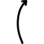
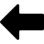
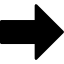
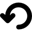

# Shuffleboard Shot Lab refactor

I want to make several improvements:

## Readability refactor

Rewrite the code to be more human readable. Follow standard JS best practices. Use comments only when the code is more complex or atypical, or changing it could introduce sneaky bugs. Split code into separate files when it makes sense to do so. Remove any dead code you find, especially unused CSS and HTML elements that CSS hides and never shows.

## Minor improvements

* Change the drag-droppable biscuits in the alley (to the sides of the court) to individual biscuits. Between what's on the board, the dead biscuits that have gone off the board and are collected on the scoring end, the biscuit currently lined up for shooting, and the remaining biscuits to be shot (the ones in the alley); there should never be more than 4 of either color. So if there is one yellow on the board, one black off the board, and one yellow lined up to shoot, in the alley there should be 3 on the black side and 2 on the yellow side.
* Add a biscuit lock to the scoring end view that makes the biscuits not draggable so when placing the intended target, it doesn't accidentally move or select a biscuit instead. Use lock/unlock icons for the toggle.
* Dragging a biscuit and dropping it anywhere off the court puts it back to the side

## Layout refactor

See the attached screenshot of rough drawings. Ask if anything is unclear.

* get rid of all unnecessary element including the "Find your line..." bit, the header can stay but should be very short. Maximize the court space and minimize unused white space.
* Collapse the "Collected" biscuits area to the depth of a biscuit and just line them up directly behind the kitchen, starting from the outer edge for each color. The goal here is viewport optimization


### Control Panel

Controls should all be buttons with icons for the button text. The icons are in the icons dir. Across the app, always give icons tooltip hover messages that have the few-word labels:

General (persistent) controls (to be saved to localStorage)

Court speed: 

* Faster court: 
* Slower court: 

Court drift: 

* Drift left: 
* Drift right: 

Shooting

Shot speed: 

* Harder shot: 
* Softer shot: 

Aim: 

* Nudge left: 
* Nudge right: 

* Make Shot: 
* Clear board: 
* Undo shot: 

## Shot Outcome Prediction feature

* When accuracy is 100%, the shot will be the same every time, so just show the shot and it's outcomes.
* When accuracy is < 100%, run the same shot 100 times (or 1000 if the added runtime is less than a second)
* Store the results of each shot. Have one object for starting state and turn info, and an array for every biscuit shot detailing where it ends up and the resulting score on the court.
  So something like:

  ```js
  shotPrediction = {
    shooting: {
      color: 'yellow', // or 'black'
      from: 'head', // or 'foot'
    },
    preShot: {
      score: [yellowScore, blackScore], 
      onTheBoard: [
        [biscuitToBeShot.x, biscuitToBeShot.y],
        [biscuit1.x, biscuit1.y],
        ...
        [biscuitN.x, biscuitN.y],
      ],
    },
    postShots: [
      {
        score: [yellowScore, blackScore],
        onTheBoard: [
          [shotBiscuit.x, shotBiscuit.y],
          [biscuit1.x, biscuit1.y],
          ...
          [biscuitN.x, biscuitN.y],
        ],
      },
      ...
    ],
  }
  ```

  This may require creating an absolute grid system for the court so that a biscuit's `[x,y]` values are the same regardless of screen size.
* for visualization:
  * create a table showing the result of the shot in terms of score delta after the shot is complete and the percentage of shots that ended with that result.
  * create a heat map. An idea I had was to render all the results but make the opacity of each one very low so that the overlapping results will show as more opaque. If this doesn't seem like it would work or there's a better way, lmk.
